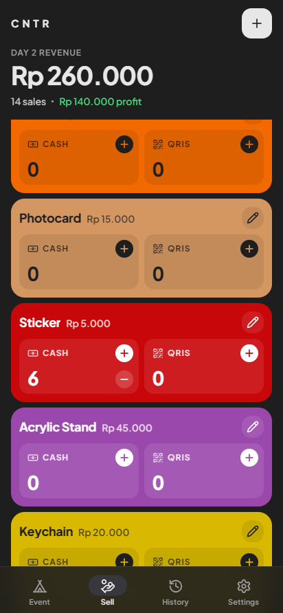
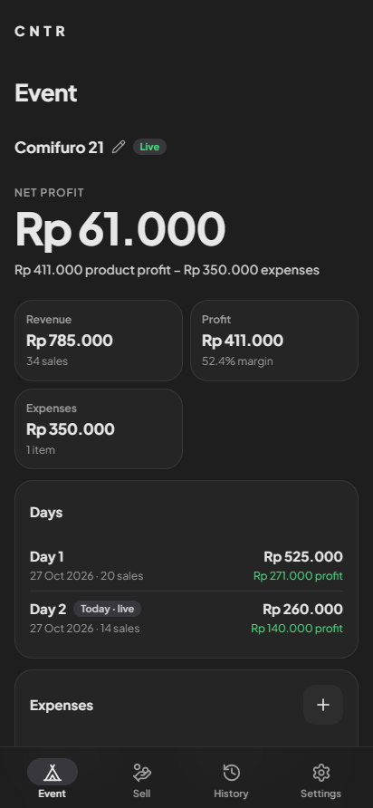
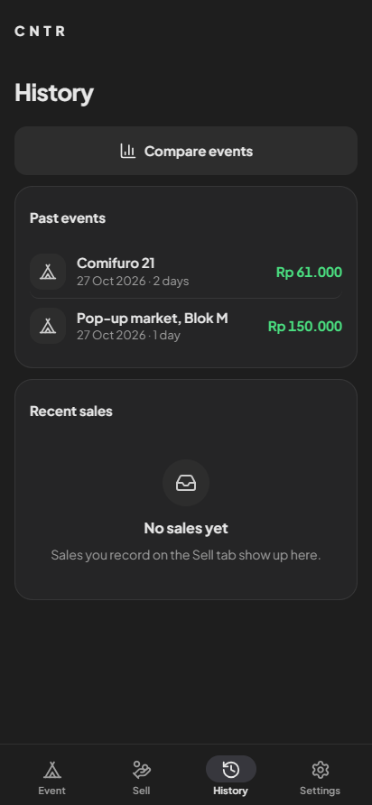
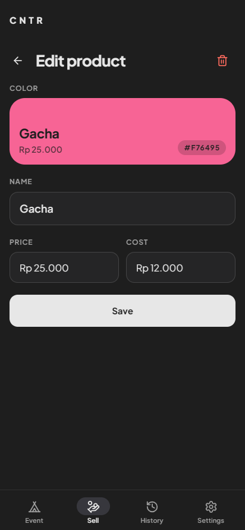

# CNTR

An offline sales counter for booths at conventions and pop-up events. Tap a product's Cash or QRIS button to record a sale; CNTR keeps a live event total, day by day, and the net profit after your booth expenses. No saving, importing or adding up by hand.

It runs entirely on the device: no server, no account, no network needed.

<p>
  
  
  
  
</p>

## Features

- **Sell**: one tile per product. Each Cash and QRIS half is a single large tap target; a small − undoes the last sale of that kind. Today's revenue and profit are shown at the top. On a phone, every tap gives haptic feedback.
- **Event** (always live): every sale counts towards the current event at once. Net profit (product profit − expenses) leads, then revenue, profit, expenses, the Cash/QRIS split, sales by hour and a per-product breakdown. Tap the name to rename it.
- **Multi-day events**: *End day* freezes today as Day 1, 2, ... (shown as day cards) and the Sell counters start again from zero; the event total keeps counting. *End event* asks for the final name and moves the event to History.
- **History**: past events with their net profit. Open one to see it in full, **edit** it (rename, fix Cash/QRIS counts per product per day, add/change/delete expenses; Save or Cancel), delete it, or compare two side by side.
- **Products**: add, edit (name, price, cost, colour), take off the counter without losing history, or delete permanently.
- **Settings**: 8 currencies (IDR, USD, EUR, SGD, AUD, GBP, JPY, MYR) and an optional compact format (`Rp 1,5M`).
- **Backup**: export all data to a JSON file (and sales to CSV), and restore from a backup after checking it.
- **Offline by design**: the font and icons are bundled into the app.
- Respects the system "reduce motion" setting.
- **Android back** (button or gesture) steps back inside the app: it closes the open sheet or menu, then goes back a screen, then to Sell; on Sell it sends the app to the background.

## Tech stack

| Layer | Tools |
|---|---|
| UI | TypeScript, [Preact](https://preactjs.com) components, plain CSS with design tokens |
| Build | [Vite](https://vitejs.dev) 5, TypeScript 5 (strict, unused-code checks on) |
| Native | [Capacitor](https://capacitorjs.com) 8 (Android; iOS project included), `@capacitor/haptics`, `@capacitor/app`, `@capacitor-community/sqlite` (storage), `@capacitor/filesystem` + `@capacitor/share` (backup files) |
| Assets | [Lucide](https://lucide.dev) SVG icons, Plus Jakarta Sans (bundled via Fontsource) |
| CI | GitHub Actions runs the tests and builds an APK on every push (release-signed when the key is in secrets) |

Code layout (details in [docs/ARCHITECTURE.md](docs/ARCHITECTURE.md)):

```
index.html          Screens and dialog shells
src/main.ts         Controller: wires controls, owns render()
src/state.ts        App state and the rules for changing it (no DOM)
src/storage.ts      Data in memory, written to SQLite on the phone (localStorage in a browser)
src/kv.ts           The SQLite and localStorage stores
src/migrate.ts      One-time copy of older localStorage data into SQLite
src/backup.ts       Backup file format, validation, CSV
src/files.ts        Saving backup files and picking one to restore
tests/              Unit tests (`npm test`); browser tests in tests/e2e (`npm run test:e2e`)
src/reports.ts      Report calculations
src/formatters.ts   Money formatting and parsing, colour helpers
src/views/          Preact components for every screen
src/ui/             Navigation, dialogs, product editor, colour picker, icons
src/style.css       Styles; design tokens at the top
android/, ios/      Capacitor native projects
```

## Getting started

Prerequisites: **Node.js 22** and npm.

```bash
npm install
npm run dev        # http://localhost:5173 (also reachable from a phone on the same Wi-Fi)
```

| Command | What it does |
|---|---|
| `npm run dev` | Dev server with hot reload |
| `npm run build` | Type-check (`tsc --noEmit`) and production build to `dist/` |
| `npm run build:watch` | Re-run the full build when `src/` changes |
| `npm run preview` | Serve the production build |
| `npm run cap:sync` | Copy `dist/` and plugins into the native projects |

## Android

Requires Android 7.0 (API 24) or newer; the app targets API 36.

**From CI (no local Android tooling needed):** every push runs the **Build APK** workflow. Open the run under **Actions** and download the artifact `CNTR_1.0.<build>.apk` (you need to be signed in to GitHub). The last number is the CI run number and also the app's `versionCode`.

> **Signing.** When the repository has the release key in its secrets (`CNTR_KEYSTORE_BASE64`, `CNTR_KEYSTORE_PASSWORD`, `CNTR_KEY_ALIAS`), CI builds a **release** APK signed with that one permanent key, plus `CNTR_1.0.<build>.aab` for Google Play. Each new release APK installs as an update and keeps the app's data. Without those secrets CI builds a **debug** APK signed with a temporary key: Android will not install it over a different build, so you must uninstall first, and **uninstalling deletes the app's data**. Switching from a debug build to the first release build also needs one uninstall.

**Locally** (needs JDK 21 and the Android SDK 36, e.g. via Android Studio):

```bash
npm run build
npx cap sync android
cd android && ./gradlew assembleDebug     # Windows: gradlew.bat assembleDebug
# → android/app/build/outputs/apk/debug/CNTR_1.0.1.apk
```

Or run `npx cap open android` and press Run in Android Studio.

**iOS:** an iOS project is included (Capacitor 8, iOS 15+) but it has not been built or tested.

## Data and backups

- CNTR works fully offline and has no server, account or sync. All data (products, the live event, past events, settings) stays on the device.
- On the phone, data is stored in an **SQLite database** in the app's private storage (`@capacitor-community/sqlite`), which the OS does not clear the way it can clear WebView storage. Older versions stored it in WebView `localStorage`; the first launch after updating copies it into the database, verifies the copy, and leaves the old copy untouched. Details in [docs/ARCHITECTURE.md](docs/ARCHITECTURE.md#storage).
- **Settings → Backup**: *Export backup* saves a JSON file of all data to `Documents/CNTR` and opens the share sheet so you can keep a copy elsewhere; *Export sales as CSV* is for spreadsheets; *Restore from backup* checks the whole file first, saves a copy of the current data, then replaces everything in one step.
- **No storage survives uninstalling the app, clearing its data, or losing the phone.** Export a backup after every event and keep it off the phone.

## Testing

Before merging, at minimum:

1. `npm test` passes (unit tests for migration, backup validation and CSV; Node's built-in runner).
2. `npm run build` passes (it includes the TypeScript check).
3. `npm run test:e2e` passes: browser tests of the built app in `tests/e2e/` (data safety including a simulated Android bridge for SQLite and backup files, core flows, Android back, layout and accessibility at 320-412px and landscape, motion). It serves `dist/` on port 4320 and uses Edge on Windows, Chrome elsewhere (`CNTR_BROWSER` overrides). CI runs both test commands on every push.
4. Run `npm run dev` and check the flows you touched in a phone-sized browser window (Sell, Event, End day / End event, History, edit, Compare, Products).
5. For native changes, install the CI APK on a real device.

## Contributing

Work on a branch and open a pull request against `main`. Keep the conventions in [docs/ARCHITECTURE.md](docs/ARCHITECTURE.md#conventions): new UI as Preact components, colours and motion from the CSS tokens, and confirmation before destructive actions. Record notable changes in [CHANGELOG.md](CHANGELOG.md).

## License

[MIT](LICENSE) © 2026 ITMERowe.

Third-party components keep their own licenses: Preact, Capacitor and Vite (MIT), Lucide icons (ISC), and Plus Jakarta Sans (SIL Open Font License 1.1).
