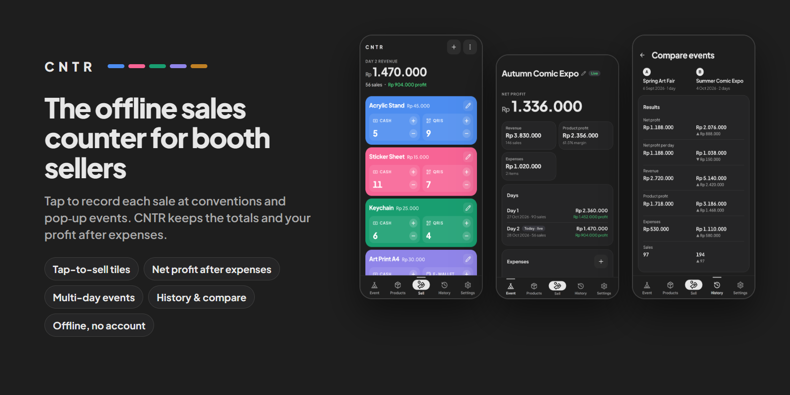

# CNTR

**An offline sales counter for booths at conventions and pop-up events.** Tap a product's payment button to record a sale; CNTR keeps today's total, the event total day by day, and your net profit after booth expenses. No account, no server, no internet needed.



## Features

- **Sell**: one colored tile per product, with a large tap target for each of its 1 or 2 payment methods (Cash, QRIS, Transfer, Card, E-wallet). A small − undoes the last sale of that kind. A free product (price 0) gets one plain counter. Today's revenue and profit sit at the top.
- **Arrange the counter**: hold a tile and drag it to reorder. The ⋮ menu has *Sort by best sellers* (most sold today first) and *Compact tiles* (shorter tiles, so more fit on screen).
- **Event** (always one live event): net profit (product profit − expenses) leads, then revenue, product profit, expenses, the payment mix and a per-product breakdown. Rename it by tapping its name.
- **Multi-day events**: *End day* starts the next day (or let a new calendar date do it, an option in Settings); the Sell counters restart while the event total keeps counting. *End event* names the event, saves an automatic backup and moves it to History.
- **Expenses**: booth fees, transport and other costs per event; they come off the net profit.
- **History**: past events with their net profit. Open one to review it, **edit** it (rename, fix counts per product per day, change expenses), delete it, or **compare** two side by side.
- **Products** tab: add, edit (name, price, cost, color, payment methods), take off the counter without losing history, or delete. A sale keeps the price it was sold at; deleting a product never deletes its sales.
- **Settings**: 8 currencies (IDR, USD, EUR, SGD, AUD, GBP, JPY, MYR) with an optional compact format (`Rp 1,5M`), light or dark theme, English or Bahasa Indonesia, sound effects, and backup.
- **Tutorial**: an optional hands-on tour on practice data, offered on first launch and replayable from Settings; your own data is set aside and comes back exactly.
- **Feedback**: haptics on every sale and action, plus optional short tones.
- **Accessible and offline**: the font and icons are bundled; respects the system "reduce motion" setting; Android back steps back through sheets and screens.

## Data and privacy

- CNTR works fully offline. It has no server, account or sync, and does not request internet access. All data (products, the live event, past events, settings) stays on the device.
- On the phone, data is stored in an **SQLite database** in the app's private storage (`@capacitor-community/sqlite`). Older versions used WebView `localStorage`; the first launch after updating copies it into the database and verifies the copy. Details in [docs/ARCHITECTURE.md](docs/ARCHITECTURE.md#storage).
- **Backups** (Settings → Backup): *Export backup* saves a JSON file of all data to `Documents/CNTR` and opens the share sheet; *Export sales as CSV* is for spreadsheets; *Restore from backup* checks the whole file first, keeps a copy of the current data, then replaces everything in one step. End event writes an automatic backup to `Documents/CNTR/auto` (the newest 20 are kept), and End day keeps one day backup there.
- Android's own Auto Backup may include the app's data in the user's Google account backup if that is turned on.
- **Uninstalling, clearing the app's data or losing the phone deletes everything** that was not exported. Export a backup after every event and keep it off the phone.

## Status and platforms

- **Android** 7.0 (API 24) or newer; targets API 36. Version `0.1.<CI run number>`; not yet published on Google Play.
- **iOS**: not built or tested. The repository has no iOS project; Capacitor can create one on a Mac with `npx cap add ios`.
- The web build runs in a browser for development and testing (data in `localStorage`).

## Tech stack

| Layer | Tools |
|---|---|
| UI | TypeScript, [Preact](https://preactjs.com) components, plain CSS with design tokens |
| Build | [Vite](https://vitejs.dev) 5, TypeScript 5 (strict) |
| Native | [Capacitor](https://capacitorjs.com) 8: `@capacitor-community/sqlite` (storage), `@capacitor/filesystem` + `@capacitor/share` (backup files), `@capacitor/haptics`, `@capacitor/app` |
| Assets | [Lucide](https://lucide.dev) icons, Plus Jakarta Sans (bundled via Fontsource) |
| CI | GitHub Actions: tests, then an APK (and a Play bundle when signed) on every push |

Code layout (details in [docs/ARCHITECTURE.md](docs/ARCHITECTURE.md)):

```
index.html          Screens and dialog shells
src/main.ts         Controller: wires controls, owns render()
src/state.ts        App state and the rules for changing it (no DOM)
src/storage.ts      Data in memory, written to SQLite on the phone (localStorage in a browser)
src/kv.ts           The SQLite and localStorage stores
src/migrate.ts      One-time copy of older localStorage data into SQLite
src/backup.ts       Backup file format, validation, CSV
src/files.ts        Saving backup files and picking one to restore
src/reports.ts      Report calculations
src/formatters.ts   Money formatting and parsing, color helpers
src/i18n.ts         English and Bahasa Indonesia strings
src/tutorial.ts     The hands-on tour and its practice data
src/views/          Preact components for every screen
src/ui/             Navigation, dialogs, product editor, color picker, tile drag, icons
src/style.css       Styles; design tokens at the top
tests/              Unit tests; browser tests in tests/e2e
android/            Capacitor Android project
```

## Getting started

Prerequisites: **Node.js 22** and npm.

```bash
npm install
npm run dev        # http://localhost:5173
```

The dev server only listens on this computer. To open it from a phone on the same Wi-Fi, run `npm run dev -- --host`, and only on a network you trust.

| Command | What it does |
|---|---|
| `npm run dev` | Dev server with hot reload |
| `npm run build` | Type-check (`tsc --noEmit`) and production build to `dist/` |
| `npm run build:watch` | Re-run the full build when `src/` changes |
| `npm run preview` | Serve the production build |
| `npm test` | Unit tests (Node's built-in runner) |
| `npm run test:e2e` | Browser tests of the built app (`dist/`) |
| `npm run cap:sync` | Copy `dist/` and plugins into the native projects |

## Building for Android

**From CI (no local Android tooling needed):** every push runs the **Build APK** workflow. Open the run under **Actions** and download `CNTR_0.1.<build>.apk` (signed in to GitHub). The last number is the CI run number and the app's `versionCode`.

> **Signing.** With the release key in the repository secrets (`CNTR_KEYSTORE_BASE64`, `CNTR_KEYSTORE_PASSWORD`, `CNTR_KEY_ALIAS`), CI builds a **release** APK signed with that permanent key, plus `CNTR_0.1.<build>.aab` for Google Play; each release installs as an update and keeps the app's data. Without those secrets CI builds a **debug** APK with a temporary key: Android will not install it over a different build, so you must uninstall first, and **uninstalling deletes the app's data**.

**Locally** (needs JDK 21 and the Android SDK 36, e.g. via Android Studio):

```bash
npm run build
npx cap sync android
cd android && ./gradlew assembleDebug     # Windows: gradlew.bat assembleDebug
```

Or run `npx cap open android` and press Run in Android Studio.

## Testing

Before merging:

1. `npm test` passes (unit tests for migration, backup validation and CSV, event and day calculations, payment methods, language, and app config such as no internet permission).
2. `npm run build` passes (includes the TypeScript check).
3. `npm run test:e2e` passes: browser tests of the built app (data safety with a simulated Android bridge for SQLite and backup files, core flows, Android back, the tutorial, layout and accessibility at 320–412px and landscape, motion). It serves `dist/` on port 4320 and uses Edge on Windows, Chrome elsewhere (`CNTR_BROWSER` overrides). CI runs both test commands on every push.
4. Check the flows you touched in a phone-sized browser window, and native changes on a real device with the CI APK.

## Contributing

Work on a branch and open a pull request against `main`. Follow the conventions in [docs/ARCHITECTURE.md](docs/ARCHITECTURE.md#conventions): new UI as Preact components, colors and motion from the CSS tokens, and confirmation before destructive actions. Record notable changes in [CHANGELOG.md](CHANGELOG.md).

## License

[MIT](LICENSE) © 2026 ITMERowe.

Third-party components keep their own licenses: Preact, Capacitor and Vite (MIT), Lucide icons (ISC), and Plus Jakarta Sans (SIL Open Font License 1.1).
