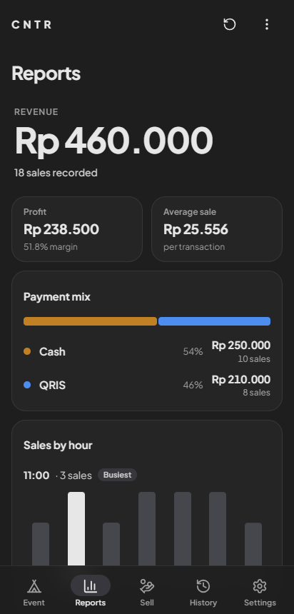

# CNTR

An offline sales counter for booths at conventions and pop-up events. Tap a product's Cash or QRIS button to record a sale; CNTR keeps running totals, a sales report, and an event report that subtracts your booth expenses.

It runs entirely on the device: no server, no account, no network needed.

<p>
  
  
  
  
</p>

## Features

- **Sell**: one tile per product. Each Cash and QRIS half is a single large tap target; a small − undoes the last sale of that kind. Revenue and profit are shown at the top. On a phone, every tap gives haptic feedback.
- **Reports**: revenue, profit and margin, average sale, the Cash/QRIS split, sales by hour (busiest hour highlighted), and a per-product breakdown.
- **Event**: import the live sales and/or saved sales reports, add expenses (booth rental, transport, ...), and see net profit or deficit.
- **Saved reports**: save sales or event snapshots, rename or delete them, and compare any two side by side.
- **Products**: add, edit (name, price, cost, colour), take off the counter without losing history, or delete permanently.
- **Settings**: 8 currencies (IDR, USD, EUR, SGD, AUD, GBP, JPY, MYR) and an optional compact format (`Rp 1,5M`).
- **Offline by design**: the font and icons are bundled into the app.
- Respects the system "reduce motion" setting.

## Tech stack

| Layer | Tools |
|---|---|
| UI | TypeScript, [Preact](https://preactjs.com) components, plain CSS with design tokens |
| Build | [Vite](https://vitejs.dev) 5, TypeScript 5 (strict, unused-code checks on) |
| Native | [Capacitor](https://capacitorjs.com) 8 (Android; iOS project included), `@capacitor/haptics` |
| Assets | [Lucide](https://lucide.dev) SVG icons, Plus Jakarta Sans (bundled via Fontsource) |
| CI | GitHub Actions builds a debug APK on every push |

Code layout (details in [docs/ARCHITECTURE.md](docs/ARCHITECTURE.md)):

```
index.html          Screens and dialog shells
src/main.ts         Controller: wires controls, owns render()
src/state.ts        App state and the rules for changing it (no DOM)
src/storage.ts      localStorage read/write
src/reports.ts      Report calculations
src/formatters.ts   Money formatting and parsing, colour helpers
src/views/          Preact components for every screen
src/ui/             Navigation, dialogs, product editor, colour picker, icons
src/style.css       Styles; design tokens at the top
android/, ios/      Capacitor native projects
```

## Getting started

Prerequisites: **Node.js 22** and npm.

```bash
npm install
npm run dev        # http://localhost:5173 (also reachable from a phone on the same Wi-Fi)
```

| Command | What it does |
|---|---|
| `npm run dev` | Dev server with hot reload |
| `npm run build` | Type-check (`tsc --noEmit`) and production build to `dist/` |
| `npm run build:watch` | Re-run the full build when `src/` changes |
| `npm run preview` | Serve the production build |
| `npm run cap:sync` | Copy `dist/` and plugins into the native projects |

## Android

Requires Android 7.0 (API 24) or newer; the app targets API 36.

**From CI (no local Android tooling needed):** every push runs the **Build APK** workflow. Open the run under **Actions** and download the artifact `CNTR_1.0.<build>.apk` (you need to be signed in to GitHub). The last number is the CI run number and also the app's `versionCode`.

> These are **debug** builds, each signed with a temporary key. Android will not install one over a different build, so uninstall first. **Uninstalling deletes the app's data.**

**Locally** (needs JDK 21 and the Android SDK 36, e.g. via Android Studio):

```bash
npm run build
npx cap sync android
cd android && ./gradlew assembleDebug     # Windows: gradlew.bat assembleDebug
# → android/app/build/outputs/apk/debug/CNTR_1.0.1.apk
```

Or run `npx cap open android` and press Run in Android Studio.

**iOS:** an iOS project is included (Capacitor 8, iOS 15+) but it has not been built or tested.

## Data and backups

- All data (products, sales, expenses, saved reports, settings) is stored in the app's WebView **`localStorage`**, on the device only. The keys are listed in [docs/ARCHITECTURE.md](docs/ARCHITECTURE.md#storage).
- There is **no sync, export or backup yet**. Uninstalling the app, or clearing its storage, deletes everything. The operating system may also clear WebView storage under storage pressure.
- Saving a report is the only way to keep a snapshot of the live sales before clearing them.

## Testing

There is no automated test suite yet. Before merging, at minimum:

1. `npm run build` passes (it includes the TypeScript check).
2. Run `npm run dev` and check the flows you touched in a phone-sized browser window (Sell, Reports, Event, Products, saved reports, Compare).
3. For native changes, install the CI APK on a real device.

## Contributing

Work on a branch and open a pull request against `main`. Keep the conventions in [docs/ARCHITECTURE.md](docs/ARCHITECTURE.md#conventions): new UI as Preact components, colours and motion from the CSS tokens, and confirmation before destructive actions. Record notable changes in [CHANGELOG.md](CHANGELOG.md).

## License

[MIT](LICENSE) © 2026 ITMERowe.

Third-party components keep their own licenses: Preact, Capacitor and Vite (MIT), Lucide icons (ISC), and Plus Jakarta Sans (SIL Open Font License 1.1).
